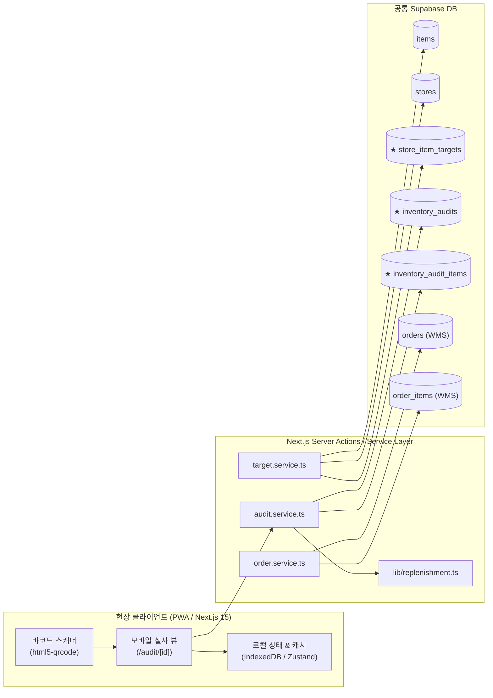
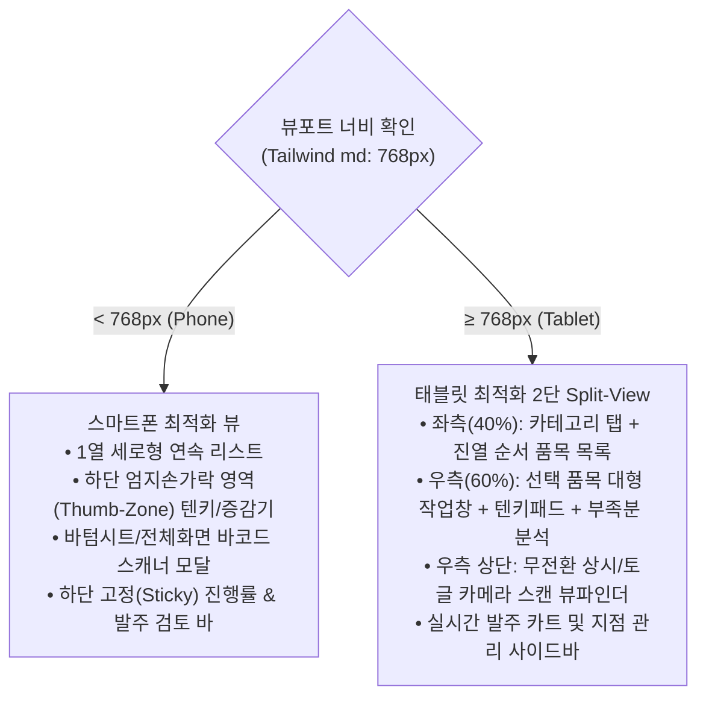

# TRD-001: Store-Inv 기술 요구사항 및 세부 설계서 (Technical Requirements Document)

> **프로젝트**: Store-Inv (대형 매장 재고 실사 & 자동 보충 발주 앱)  
> **관련 문서**: [01_PRD.md](01_PRD.md) | [02_ADR.md](02_ADR.md) | [DEVELOPMENT_PLAN.md](DEVELOPMENT_PLAN.md)  
> **데이터베이스**: WMS 공통 Supabase (PostgreSQL 14.5)  

---

## 1. 아키텍처 개요 및 데이터베이스 연동 구조

Store-Inv는 독립된 백엔드 없이 **기존 WMS/G-Manager가 사용하는 단일 Supabase 인스턴스에 직접 연결**됩니다.



---

## 2. 데이터베이스 스키마 설계

### 2.1 기존 WMS 재사용 테이블 (Read & Reference)

| 테이블명 | 주요 참조 컬럼 | 용도 |
| :--- | :--- | :--- |
| `stores` | `id`, `name`, `store_no`, `address` | 실사 대상 대형 매장(Food Depot 등) 정보 조회 |
| `items` | `id`, `sku`, `name_en`, `upc`, `box_barcode`, `units_per_box`, `unit_price`, `box_price`, `category`, `image_url`, `is_active`, `client_id` | 제품 마스터, 바코드 스캔 매칭, 박스 입수량 및 단가 조회 |
| `users` | `id`, `first_name`, `last_name`, `role` | 실사자(Auditor) 식별 및 권한 확인 |
| `orders` | `id`, `order_no`, `store_id`, `client_id`, `status`, `order_date`, `note`, `user_id` | 실사 완료 시 부족분 자동 발주 생성 (WMS 주문 큐 등록) |
| `order_items` | `id`, `order_id`, `item_id`, `qty`, `price`, `uom` | 발주 상세 품목 등록 |

---

### 2.2 신규 확장 테이블 DDL (PostgreSQL Migration)

#### 1) 매장별 품목 기준 재고 (`store_item_targets`)
각 매장의 진열대 크기와 회전율에 따른 적정 재고(PAR) 및 진열 순서를 정의합니다.

```sql
CREATE TABLE IF NOT EXISTS public.store_item_targets (
    id UUID PRIMARY KEY DEFAULT gen_random_uuid(),
    store_id UUID NOT NULL REFERENCES public.stores(id) ON DELETE CASCADE,
    item_id UUID NOT NULL REFERENCES public.items(id) ON DELETE CASCADE,
    par_level INTEGER NOT NULL DEFAULT 0 CHECK (par_level >= 0),
    min_order_qty INTEGER NOT NULL DEFAULT 1 CHECK (min_order_qty >= 1),
    display_order INTEGER NOT NULL DEFAULT 0,
    is_active BOOLEAN NOT NULL DEFAULT true,
    created_at TIMESTAMPTZ NOT NULL DEFAULT now(),
    updated_at TIMESTAMPTZ NOT NULL DEFAULT now(),
    UNIQUE(store_id, item_id)
);

CREATE INDEX idx_store_item_targets_store ON public.store_item_targets(store_id, display_order);
```

#### 2) 매장 PAR 변경 이력 (`store_target_logs`)
비정기적인 PAR 변경 일시, 변경자, 이전/신규 수치 및 변경 사유를 추적합니다.

```sql
CREATE TABLE IF NOT EXISTS public.store_target_logs (
    id UUID PRIMARY KEY DEFAULT gen_random_uuid(),
    store_id UUID NOT NULL REFERENCES public.stores(id) ON DELETE CASCADE,
    item_id UUID NOT NULL REFERENCES public.items(id) ON DELETE CASCADE,
    old_par INTEGER NOT NULL,
    new_par INTEGER NOT NULL,
    reason TEXT, -- 예: "매대 확장", "주말 프로모션 대비 증량", "비정기 조정"
    changed_by UUID REFERENCES public.users(id),
    created_at TIMESTAMPTZ NOT NULL DEFAULT now()
);

CREATE INDEX idx_store_target_logs ON public.store_target_logs(store_id, item_id, created_at DESC);
```

#### 3) 매장 실사 세션 헤더 (`inventory_audits`)
현장 담당자가 특정 매장을 방문하여 시작하고 마감한 실사 작업 단위입니다.

```sql
CREATE TYPE public.audit_status AS ENUM ('in_progress', 'submitted', 'cancelled');

CREATE TABLE IF NOT EXISTS public.inventory_audits (
    id UUID PRIMARY KEY DEFAULT gen_random_uuid(),
    store_id UUID NOT NULL REFERENCES public.stores(id) ON DELETE RESTRICT,
    auditor_id UUID NOT NULL REFERENCES public.users(id) ON DELETE RESTRICT,
    status public.audit_status NOT NULL DEFAULT 'in_progress',
    order_id UUID REFERENCES public.orders(id) ON DELETE SET NULL, -- 생성된 WMS 발주 ID
    started_at TIMESTAMPTZ NOT NULL DEFAULT now(),
    submitted_at TIMESTAMPTZ,
    notes TEXT,
    created_at TIMESTAMPTZ NOT NULL DEFAULT now(),
    updated_at TIMESTAMPTZ NOT NULL DEFAULT now()
);

CREATE INDEX idx_inventory_audits_store ON public.inventory_audits(store_id, created_at DESC);
```

#### 3) 실사 품목 상세 내역 (`inventory_audit_items`)
실사 당시 현장 진열 수량과 자동 산출된 발주량, 최종 조정 수량, 그리고 반품(Return) 및 자동 산출된 Credit 금액을 기록합니다.

```sql
CREATE TYPE public.return_reason_type AS ENUM ('DAMAGED', 'OUT_OF_DATE', 'DEFECTIVE', 'OTHER');

CREATE TABLE IF NOT EXISTS public.inventory_audit_items (
    id UUID PRIMARY KEY DEFAULT gen_random_uuid(),
    audit_id UUID NOT NULL REFERENCES public.inventory_audits(id) ON DELETE CASCADE,
    item_id UUID NOT NULL REFERENCES public.items(id) ON DELETE RESTRICT,
    physical_count INTEGER NOT NULL DEFAULT 0 CHECK (physical_count >= 0),
    target_par INTEGER NOT NULL DEFAULT 0,
    deficit_qty INTEGER NOT NULL DEFAULT 0,
    suggested_order_qty INTEGER NOT NULL DEFAULT 0,
    final_order_qty INTEGER NOT NULL DEFAULT 0 CHECK (final_order_qty >= 0),
    adjustment_reason TEXT,
    return_qty INTEGER NOT NULL DEFAULT 0 CHECK (return_qty >= 0),
    return_reason public.return_reason_type,
    return_note TEXT,
    unit_price NUMERIC(10, 2) NOT NULL DEFAULT 0,
    credit_amount NUMERIC(10, 2) NOT NULL DEFAULT 0,
    created_at TIMESTAMPTZ NOT NULL DEFAULT now(),
    updated_at TIMESTAMPTZ NOT NULL DEFAULT now(),
    UNIQUE(audit_id, item_id)
);

CREATE INDEX idx_inventory_audit_items_audit ON public.inventory_audit_items(audit_id);
```

#### 4) 매장 반품 및 Credit 원장 (`store_credits`)
실사 또는 반품 등록 시 `(단가 - 단가의 5%) * 갯수` 공식에 의해 해당 매장에 자동 부여된 Credit 내역을 보관합니다.

```sql
CREATE TABLE IF NOT EXISTS public.store_credits (
    id UUID PRIMARY KEY DEFAULT gen_random_uuid(),
    store_id UUID NOT NULL REFERENCES public.stores(id) ON DELETE CASCADE,
    audit_id UUID REFERENCES public.inventory_audits(id) ON DELETE SET NULL,
    item_id UUID NOT NULL REFERENCES public.items(id) ON DELETE RESTRICT,
    return_qty INTEGER NOT NULL CHECK (return_qty > 0),
    return_reason public.return_reason_type NOT NULL DEFAULT 'DAMAGED',
    unit_price NUMERIC(10, 2) NOT NULL DEFAULT 0,
    credit_unit_price NUMERIC(10, 2) NOT NULL DEFAULT 0, -- unit_price * 0.95
    credit_amount NUMERIC(10, 2) NOT NULL DEFAULT 0,     -- (unit_price - unit_price * 0.05) * return_qty
    note TEXT,
    status TEXT NOT NULL DEFAULT 'ISSUED', -- ISSUED, APPLIED, CANCELLED
    created_at TIMESTAMPTZ NOT NULL DEFAULT now()
);

CREATE INDEX idx_store_credits_store ON public.store_credits(store_id, created_at DESC);
```

---

## 3. 핵심 비즈니스 로직: 자동 보충 발주 알고리즘

### 3.1 계산 공식
```typescript
interface ReplenishmentInput {
  physicalCount: number;      // 현장 실사 진열 수량
  parLevel: number;           // 매장 기준 적정 재고
  unitsPerBox: number | null; // 박스당 입수량 (기본값: 1)
  minOrderQty?: number;       // 최소 발주 단위
  roundToBox?: boolean;       // 박스 단위 올림 적용 여부 (기본 true)
}

interface ReplenishmentResult {
  deficitQty: number;         // 단순 부족분
  suggestedQty: number;       // 자동 추천 발주 수량
  boxCount: number;           // 박스 수량
}
```

```typescript
export function calculateReplenishment(input: ReplenishmentInput): ReplenishmentResult {
  const { physicalCount, parLevel, unitsPerBox = 1, minOrderQty = 1, roundToBox = true } = input;
  const boxSize = unitsPerBox && unitsPerBox > 0 ? unitsPerBox : 1;

  // 1. 단순 부족분 산출 (음수 방지)
  const deficitQty = Math.max(0, parLevel - physicalCount);

  if (deficitQty === 0) {
    return { deficitQty: 0, suggestedQty: 0, boxCount: 0 };
  }

  // 2. 박스 단위 올림 계산 (Case Pack Rounding)
  let suggestedQty = deficitQty;
  let boxCount = 1;

  if (roundToBox && boxSize > 1) {
    boxCount = Math.ceil(deficitQty / boxSize);
    suggestedQty = boxCount * boxSize;
  } else {
    boxCount = Math.ceil(suggestedQty / boxSize);
  }

  // 3. 최소 주문 단위(MOQ) 충족 검증
  if (suggestedQty < minOrderQty) {
    suggestedQty = minOrderQty;
    boxCount = Math.ceil(suggestedQty / boxSize);
  }

  return { deficitQty, suggestedQty, boxCount };
}
```

### 3.2 반품(Return) Credit 자동 계산 공식
매장에서 파손(`DAMAGED`) 또는 유통기한 경과(`OUT_OF_DATE`) 등의 사유로 반품 등록 시, 매장 Credit은 품목 단가(`unit_price`)에서 5%를 차감한 단가에 반품 수량을 곱하여 산출합니다.

```typescript
export function calculateReturnCredit(unitPrice: number, returnQty: number): {
  unitPrice: number;
  discountedUnitPrice: number;
  returnQty: number;
  creditAmount: number;
} {
  const validUnitPrice = Math.max(0, Number(unitPrice) || 0);
  const validQty = Math.max(0, Math.floor(Number(returnQty) || 0));
  const discountedUnitPrice = Number((validUnitPrice - validUnitPrice * 0.05).toFixed(4));
  const creditAmount = Number(((validUnitPrice - validUnitPrice * 0.05) * validQty).toFixed(2));
  return {
    unitPrice: validUnitPrice,
    discountedUnitPrice,
    returnQty: validQty,
    creditAmount,
  };
}
```

---

## 4. WMS 발주 연계 트랜잭션 (Atomic Order Creation)

실사 완료 및 발주 제출 버튼 클릭 시, PostgreSQL RPC 또는 트랜잭션으로 다음 순서로 실행됩니다.

```sql
-- 함수 시그니처: submit_store_audit_order
CREATE OR REPLACE FUNCTION public.submit_store_audit_order(
    p_audit_id UUID,
    p_user_id UUID,
    p_notes TEXT DEFAULT NULL
) RETURNS UUID AS $$
DECLARE
    v_audit RECORD;
    v_order_id UUID;
    v_order_no TEXT;
    v_client_id UUID;
    v_today TEXT;
    v_seq INT;
BEGIN
    -- 1. 실사 세션 유효성 확인
    SELECT * INTO v_audit FROM public.inventory_audits 
    WHERE id = p_audit_id AND status = 'in_progress' FOR UPDATE;
    
    IF NOT FOUND THEN
        RAISE EXCEPTION 'Audit session is not found or already submitted';
    END IF;

    -- 2. 주문 번호 생성 (형식: SO-YYYYMMDD-XXXX)
    v_today := to_char(now(), 'YYYYMMDD');
    SELECT count(*) + 1 INTO v_seq FROM public.orders 
    WHERE order_no LIKE 'SO-' || v_today || '-%';
    v_order_no := 'SO-' || v_today || '-' || lpad(v_seq::text, 4, '0');

    -- 3. 매장의 대표 client_id 조회 (items 테이블의 기준 client_id)
    SELECT client_id INTO v_client_id FROM public.items WHERE is_active = true LIMIT 1;

    -- 4. WMS orders 테이블에 생성 (상태: PENDING)
    INSERT INTO public.orders (
        order_no,
        store_id,
        client_id,
        status,
        order_date,
        note,
        user_id
    ) VALUES (
        v_order_no,
        v_audit.store_id,
        v_client_id,
        'PENDING',
        now()::date::text,
        COALESCE(p_notes, '[Store-Inv] Food Depot 실사 자동 발주'),
        p_user_id
    ) RETURNING id INTO v_order_id;

    -- 5. 발주 수량이 1개 이상인 품목을 order_items에 일괄 삽입
    INSERT INTO public.order_items (
        order_id,
        item_id,
        qty,
        price,
        uom
    )
    SELECT 
        v_order_id,
        ai.item_id,
        ai.final_order_qty,
        COALESCE(i.unit_price, 0),
        COALESCE(i.uom, 'EA')
    FROM public.inventory_audit_items ai
    JOIN public.items i ON i.id = ai.item_id
    WHERE ai.audit_id = p_audit_id AND ai.final_order_qty > 0;

    -- 6. 실사 세션 상태 업데이트 (submitted 및 생성된 order_id 바인딩)
    UPDATE public.inventory_audits
    SET status = 'submitted',
        order_id = v_order_id,
        submitted_at = now(),
        notes = p_notes,
        updated_at = now()
    WHERE id = p_audit_id;

    RETURN v_order_id;
END;
$$ LANGUAGE plpgsql;

-- 4.2 매장 간 PAR 복사 함수 (Clone Store Targets)
CREATE OR REPLACE FUNCTION public.clone_store_targets(
    p_source_store_id UUID,
    p_target_store_id UUID,
    p_overwrite BOOLEAN DEFAULT false
) RETURNS INTEGER AS $$
DECLARE
    v_copied_count INT;
BEGIN
    IF p_overwrite THEN
        DELETE FROM public.store_item_targets WHERE store_id = p_target_store_id;
    END IF;

    INSERT INTO public.store_item_targets (
        store_id,
        item_id,
        par_level,
        min_order_qty,
        display_order,
        is_active
    )
    SELECT 
        p_target_store_id,
        item_id,
        par_level,
        min_order_qty,
        display_order,
        is_active
    FROM public.store_item_targets
    WHERE store_id = p_source_store_id
    ON CONFLICT (store_id, item_id) DO UPDATE
    SET par_level = EXCLUDED.par_level,
        min_order_qty = EXCLUDED.min_order_qty,
        display_order = EXCLUDED.display_order,
        is_active = EXCLUDED.is_active,
        updated_at = now();

    GET DIAGNOSTICS v_copied_count = ROW_COUNT;
    RETURN v_copied_count;
END;
$$ LANGUAGE plpgsql;
```

---

## 5. 서비스 레이어 및 Server Actions 명세

```
src/services/
├── target.service.ts     # 매장별 PAR 및 취급 품목 조회/관리/복사/일괄수정
├── audit.service.ts      # 실사 세션 생성, 임시 저장, 조회
└── order.service.ts      # WMS 발주 제출 및 상태 확인
```

### 주요 Server Actions

#### A. 매장 PAR 관리 (`app/actions/targets.ts`)
1. `getStoreTargetsAction(storeId: string)`:
   * 해당 매장의 취급 품목 및 현재 PAR Level, 진열 순서 조회.
2. `updateStoreTargetAction(targetId: string, newPar: number, reason?: string)`:
   * 특정 품목의 PAR 변경 및 `store_target_logs` 이력 기록.
3. `batchUpdateStoreTargetsAction(storeId: string, updates: Array<{ itemId: string; parLevel: number; displayOrder: number }>, reason?: string)`:
   * 인라인 그리드 또는 CSV 일괄 업로드 처리.
4. `cloneStoreTargetsAction(sourceStoreId: string, targetStoreId: string, overwrite: boolean)`:
   * 타 매장 PAR 기준 원클릭 복사.

#### B. 현장 실사 및 발주 (`app/actions/audit.ts`)
1. `startAuditAction(storeId: string)`:
   * 새 실사 세션 생성 (`in_progress`)
   * 매장의 `store_item_targets` 기준 품목들을 `inventory_audit_items`에 초기화 (당시의 최신 PAR 수치를 `target_par`에 스냅샷 고정)
2. `saveAuditDraftAction(auditId: string, items: Array<{ itemId: string; physicalCount: number; finalOrderQty: number }>)`:
   * 현장 실사 입력값 실시간 임시 저장 (Debounce/Batch)
3. `submitAuditOrderAction(auditId: string, notes?: string)`:
   * 최종 검토 완료 후 `submit_store_audit_order` RPC 호출
   * 성공 시 WMS 주문 번호 및 발주 요약 반환

---

## 6. 오프라인 & 예외 처리 정책

1. **오프라인 감지 시**:
   * 브라우저 `navigator.onLine` 상태 감지.
   * 네트워크 오프라인 시 UI 상단에 주황색 **오프라인 모드 배너** 표시.
   * 모든 입력값은 즉시 `IndexedDB`에 로컬 캐시.
2. **네트워크 복구 시**:
   * 대기 중이던 로컬 입력 큐를 `saveAuditDraftAction`으로 일괄 동기화.
   * 최종 발주 제출(`submitAuditOrderAction`)은 반드시 온라인 상태가 확인된 경우에만 활성화.
3. **바코드 스캔 예외**:
   * 카메라 미지원 또는 조도 부족 시 수동 검색창(SKU/품목명) 상시 제공.

---

## 7. Phone & Tablet 반응형 UI 아키텍처 및 화면 구현 명세

### 7.1 디바이스별 레이아웃 분기 (Adaptive Viewports)



### 7.2 주요 컴포넌트 반응형 분기 명세

| 화면 / 컴포넌트 | Phone 모드 (`< 768px`) | Tablet 모드 (`≥ 768px`) |
| :--- | :--- | :--- |
| **실사 메인 (`/audit/[id]`)** | • 단일 열 품목 카드 리스트<br/>• 현재 선택된 품목 인라인 강조<br/>• 하단 고정 퀵 패널 (`-1`, `+1`, `+5`, `+10`) | • 2단 Split-View (좌: 목록 40%, 우: 상세 60%)<br/>• 좌측 목록에서 품목 탭 시 우측 상세창 즉각 렌더링<br/>• 분할 화면 내 대형 텐키패드 상시 노출 |
| **바코드 스캐너 (`BarcodeScanner`)** | • 플로팅 스캔 버튼 ➔ 바텀시트/풀 모달 팝업<br/>• 스캔 완료 즉시 사운드 + 닫히며 해당 아이템으로 스크롤 | • 우측 상단 고정 또는 인라인 뷰파인더 위젯<br/>• 화면 전환 없이 스캔과 품목 리스트를 동시 시청 |
| **수량 입력기 (`AuditItemInput`)** | • 하단 팝업 텐키패드 또는 터치 증감 버튼<br/>• 엄지손가락 반경 내 배치 (높이 최소 48px) | • 우측 패널 내 대형 데스크/태블릿용 계산기 UI<br/>• 키보드 숫자키 및 터치 텐키 동시 지원 |
| **발주 검토 (`/audit/[id]/review`)** | • 아코디언/카드형 발주 품목 리스트<br/>• 하단 Sticky 최종 발주 승인 버튼 | • 2단 대시보드 뷰 (좌: 품목 테이블, 우: 발주 요약 및 서명/메모 카드)<br/>• 한눈에 결품 품목과 총 박스 수 비교 |
| **PAR 관리 (`/settings/targets`)** | • 매장/품목별 카드 리스트 + 팝업 인라인 수정 | • 대화면 고밀도 인라인 데이터 그리드 (Excel 스타일) |

### 7.3 반응형 상태 관리 (`useAuditStore`)
- Phone과 Tablet 간 레이아웃 전환(화면 회전, 기기 전환) 시에도 Zustand 스토어의 데이터 무결성을 보장합니다.
- `focusedItemId`, `auditItemsMap`, `scanMode`, `offlineQueue` 등 핵심 상태는 디바이스 뷰포트와 무관하게 전역 싱글톤으로 유지됩니다.
