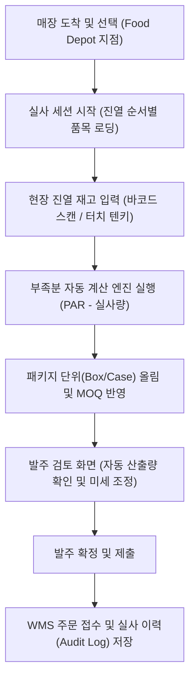
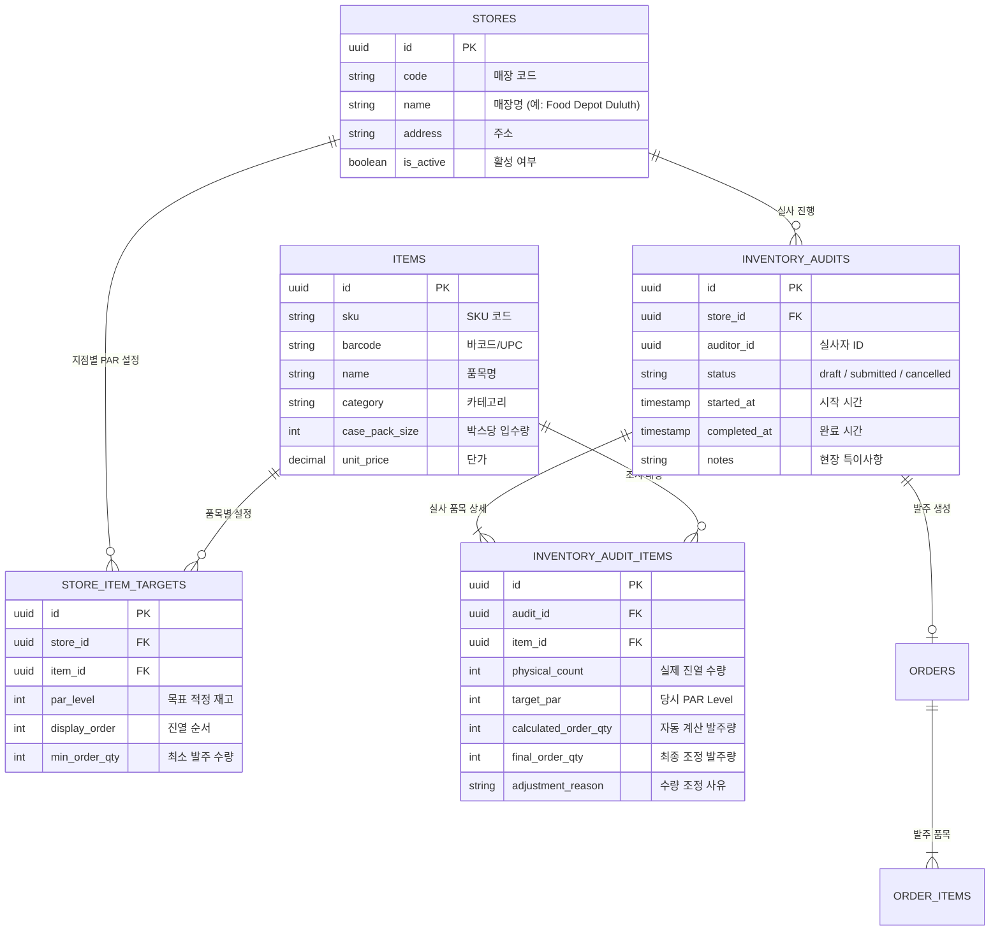
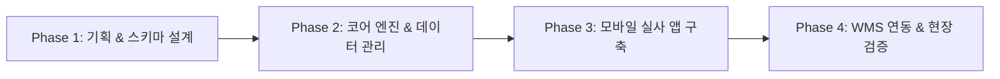

# 대형 매장(Food Depot) 현장 재고 실사 및 자동 보충 발주 앱 (Store-Inv)
## 통합 개발 계획서 (Development Plan & Phase Roadmap)

> **프로젝트명**: Store-Inv (대형 매장 재고조사 & 자동 발주 시스템)  
> **문서 버전**: v1.0.0  
> **작성일**: 2026-11-06  
> **대상 매장**: Food Depot 및 주요 대형 체인 매장  
> **연계 시스템**: 기존 WMS / Orderapp 데이터 파이프라인  

---

## 1. 프로젝트 개요 및 배경 (Background & Vision)

### 1.1 배경
* 당사 제품이 진열되어 있는 대형 매장(Food Depot 등)의 재고 관리는 결품(Out of Stock)으로 인한 매출 손실 방지와 과다 재고 방지가 핵심입니다.
* 기존에는 현장 직원이 매장을 순회하며 수기로 재고를 적고, 사무실로 돌아오거나 전화를 통해 별도로 발주 수량을 계산하여 입력하는 비효율적인 프로세스를 거쳤습니다.

### 1.2 목표
* **원스톱 현장 처리**: 모바일 앱을 통해 현장에서 진열대 실사 재고를 입력하는 즉시, 사전에 정의된 매장별 기준 적정 재고(PAR Level)를 기반으로 **부족분을 자동 계산하여 본사 WMS로 즉시 발주를 전송**합니다.
* **실사 소요 시간 단축**: 매장당 1~2분 내 실사 완료 가능한 모바일 고속 입력 환경(바코드 스캔, 텐키패드, 진열 순서 정렬)을 제공합니다.

---

## 2. 핵심 업무 흐름 (User Flow)

---

## 3. 주요 기능 명세

### 3.1 모바일 퍼스트 현장 UI/UX
1. **초고속 텐키 & 증감 터치**: 진열대를 보며 한 손으로 빠르게 입력 가능한 대형 터치 버튼 (`+1`, `+5`, `+10`, `-1`).
2. **카메라 바코드(UPC) 스캔**: 제품 바코드 스캔 시 해당 품목으로 즉시 스크롤 및 포커스.
3. **진열 동선 맞춤 정렬**: 매장 진열대 배치 순서(Sort Order)대로 품목이 정렬되어 이동 동선 최소화.
4. **오프라인/음영지역 자동 복구**: 대형 마트 내부의 통신 단절 시에도 로컬 캐시(IndexedDB/LocalStorage)에 실사 내용 임시 저장, 네트워크 재연결 시 자동 동기화.

### 3.2 스마트 보충 발주 엔진 (Replenishment Engine)
1. **PAR Level 기반 부족분 산출**:
   $$\text{부족분(Deficit)} = \max(0, \text{PAR Level} - \text{실사 재고} - \text{미입고 배송중 수량})$$
2. **박스/번들 단위(Pack/Case Size) 자동 라운딩**:
   * 낱개 부족분을 최소 출하 단위인 박스(Case) 단위로 자동 올림 계산.
3. **최소 발주 수량(MOQ) 검증**:
   * 기준 미달 시 경고 또는 최소 발주 단위로 자동 보정.

### 3.3 관리 및 WMS 연동
1. **매장별 동적 PAR Level 비정기 관리 뷰**: 지점별/품목별 목표 재고(PAR) 및 진열 순서 설정 (인라인 그리드 편집, 타 매장 설정 복사, CSV 대량 업로드).
2. **PAR 변경 이력 추적 & 실사 스냅샷 불변성**: PAR 변경자 및 사유 로깅(`store_target_logs`), 과거 실사 당시의 PAR 수치 영구 보존.
3. **기존 WMS `orders` / `order_items` 파이프라인 연계**: 별도 승인 절차 없이 또는 매니저 확인 즉시 본사 출고 큐에 등록.
4. **실사 이력(Audit History)**: 실사 일시, 실사자, 당시 재고, 발주 수량 데이터 아카이빙.

---

## 4. 데이터 모델 설계 (Data Architecture)

---

## 5. 단계별 상세 개발 로드맵 (Detailed Phase Breakdown)

본 로드맵은 설계 우선(Design-First) 원칙과 1인 개발/SaaS-First 체계에 맞춰 4단계로 구성됩니다.

---

### [Phase 1] 기획, 아키텍처 및 데이터 스키마 확정 (Design-First)

* **목표**: 구현 착수 전 요구사항, 계산식, DB 스키마, API 인터페이스를 명문화하여 설계 변경 비용을 최소화.
* **기간(예상)**: 1~2일

#### 상세 태스크:
1. **문서화 (PRD / ADR / TRD 작성)**
   * `docs/01_PRD.md`: 기능 범위(MVP Scope) 및 제외 사항(Out of Scope) 확정.
   * `docs/02_ADR.md`: Next.js 15 App Router, Supabase RLS, 상태관리(Zustand), 모바일 스캐너 라이브러리 선정 근거 기록.
   * `docs/03_TRD.md`: 데이터 스키마 정의, API 라우트 시그니처, 보충 발주 알고리즘 명세.
2. **데이터베이스 설계 및 마이그레이션 스크립트 작성**
   * Supabase 상에 `stores`, `items`, `store_item_targets`, `inventory_audits`, `inventory_audit_items` 테이블 DDL 작성.
   * 외래키 제약조건, 인덱스(매장별+바코드, 진열순서), RLS 정책 설정.
3. **환경 구성 및 프로젝트 베이스라인 세팅**
   * 프로젝트 의존성 설치 (Next.js, Tailwind CSS v4, Lucide Icons, html5-qrcode 등).
   * Supabase 클라이언트 및 TypeScript 타입 정의(`types/supabase.ts`) 생성.

* **산출물**:
  * `docs/01_PRD.md`, `docs/02_ADR.md`, `docs/03_TRD.md`
  * Supabase 마이그레이션 SQL 스크립트
  * 기본 프로젝트 실행 환경

---

### [Phase 2] 코어 비즈니스 로직 및 기준 데이터(PAR Level) 관리 (Core Engine & Data Foundation)

* **목표**: 매장별 목표 재고(PAR)를 설정하고, 실사 입력값에 따라 부족분을 정확히 산출하는 비즈니스 로직 구축.
* **기간(예상)**: 2~3일

#### 상세 태스크:
1. **기준 재고(PAR Level) 관리 기능 구현**
   * `services/target.service.ts`: 매장별 취급 품목 및 목표 재고(PAR), 진열 순서 조회/수정 로직.
   * 매장별 PAR Level 설정/조회 관리자 화면 (간편 그리드 뷰).
2. **보충 발주 계산 엔진 (Replenishment Calculation Engine) 구현**
   * `lib/replenishment.ts`:
     * 부족 수량 산출: `Deficit = max(0, PAR - PhysicalCount - InTransit)`
     * 박스(Case) 단위 라운딩: `OrderQty = ceil(Deficit / CasePackSize) * CasePackSize`
     * 최소 주문 수량(MOQ) 조건 체크
   * 계산 로직에 대한 유닛 테스트(Vitest) 작성 (경계값 테스트: 재고 초과, 재고 0, 음수 방지, 박스 단위 절상 검증).
3. **실사 세션 관리 서비스 레이어 구축**
   * `services/audit.service.ts`:
     * 새 실사 세션 생성 (`createAuditSession`)
     * 실사 진행 중 임시 저장 (`saveAuditDraft`)
     * 세션 마감 및 결과 확정 (`finalizeAuditSession`)

* **산출물**:
  * 매장별 PAR Level 관리 API 및 서비스
  * 단위 테스트를 통과한 자동 보충 발주 계산 엔진
  * 실사 세션 수명주기 관리 서비스

---

### [Phase 3] 현장 특화 반응형 실사 웹 인터페이스 (Phone & Tablet Adaptive App)

* **목표**: 현장 담당자가 Food Depot 매장에서 스마트폰(한 손 썸존 조작) 및 태블릿(2단 Split-View 분할 조작)으로 빠르고 직관적으로 실사하고 발주량을 확인할 수 있는 기기 적응형 반응형 UI 구축.
* **기간(예상)**: 3~4일

#### 상세 태스크:
1. **매장 선택 및 실사 진입 화면 (`/audit`)**
   * 매장 검색 및 최근 방문 지점 퀵 버튼.
   * 진행 중이던 미완료 실사가 있을 경우 "이어하기" 모달 제공.
2. **Phone & Tablet 적응형 고속 실사 입력 뷰 (`/audit/[id]`)**
   * **Phone 모드 (`< 768px`)**: 단일 열 리스트 + 하단 엄지손가락 영역(Thumb-Zone) 컨트롤러 (`-1`, `+1`, `+5`, `+10`, 팝업 텐키) + 바텀시트 스캐너.
   * **Tablet 모드 (`≥ 768px`)**: 2단 분할(Split-View) 레이아웃 (좌: 품목 목록 40%, 우: 상세 텐키패드/계산기 및 실시간 부족 박스 분석 60%).
   * **진열 순서별 정렬**: 카테고리 뱃지, 품목명, 현재 PAR 기준치, 박스당 입수량 표시.
   * **실시간 계산 피드백**: 실사 수량 입력 즉시 옆에 계산된 `부족: N박스` 뱃지 노출.
   * **진행률 인디케이터**: 총 품목 대비 입력 완료 품목 수 (예: `18 / 25 완료`) 및 총 발주 박스 수.
3. **카메라 바코드(UPC) 스캐너 연동**
   * HTML5 카메라 스캔 기능 구현 (`components/features/BarcodeScanner.tsx`).
   * Phone: 바텀시트 팝업 모달 스캔 / Tablet: 우측 상단 인라인/상시 뷰파인더 연동.
   * 바코드 인식 시 해당 품목으로 자동 스크롤 및 입력창 자동 포커스 (비프음/진동 햅틱 지원).
4. **오프라인 및 네트워크 단절 대응 (Offline Resilience)**
   * 매장 내부 전파 음영 지역 대비 `LocalStorage / IndexedDB` 자동 동기화.
   * 네트워크 복구 시 서버로 일괄 업데이트(Debounce / Batch).

* **산출물**:
  * Phone & Tablet 반응형 실사 입력 화면 및 컴포넌트 (`AuditItemInput`, `QuickStepper`, `NumpadModal`)
  * 적응형 바코드 스캐너 기능 (Phone 바텀시트 / Tablet 인라인 뷰)
  * 로컬 임시 저장 및 네트워크 단절 보호 메커니즘

---

### [Phase 4] 발주 검토, WMS 연동 및 현장 검증 (Order Review, WMS Pipeline & Pilot)

* **목표**: 자동 산출된 발주량을 검토/조정하여 기존 WMS 주문으로 최종 전송하고, 매장 현장 파일럿 테스트를 통한 완성도 확보.
* **기간(예상)**: 2~3일

#### 상세 태스크:
1. **발주 검토 및 미세 조정 화면 (`/audit/[id]/review`)**
   * 자동 산출된 발주 내역 요약 (총 품목 수, 총 박스 수, 발주 금액 합계).
   * 현장 상황 반영: 수량 수동 증감 및 사유 입력(예: "주말 특가 행사로 2박스 추가").
2. **기존 WMS / Orderapp 파이프라인 연계**
   * 최종 확정 시 WMS 주문 테이블(`orders`, `order_items`) 트랜잭션 삽입.
   * 주문 타입 구분: `store_replenishment` 태그 지정.
   * 실사 세션 상태를 `submitted`로 전환하고 완료 리포트 화면 제공.
3. **실사 이력 및 통계 조회 (`/history`)**
   * 지점별 실사 히스토리, 일자별 실사자, 발주량 조회.
4. **Food Depot 매장 현장 파일럿 테스트 및 안정화**
   * 실제 매장 진열대 환경에서 바코드 인식률, 조작 편의성, 입력 소요 시간 측정.
   * 현장 피드백 반영 (버튼 크기, 사운드 피드백, 햅틱 반응 등 UX 튜닝).

* **산출물**:
  * 발주 검토 및 확정 화면
  * WMS 주문 연동 API 및 트랜잭션 로직
  * 매장 현장 검증 완료 및 최종 릴리즈

---

## 6. 성공 검증 지표 (Success Metrics)

| 지표명 | 목표치 | 검증 방법 |
| :--- | :--- | :--- |
| **실사 및 발주 소요 시간** | 매장당 **3분 이내** | 현장 테스트 시간 측정 |
| **발주 계산 정확도** | **100%** (오차 0건) | 유닛 테스트 및 WMS 주문 대조 |
| **바코드 스캔 인식률** | **95% 이상** (정상 바코드 기준) | 현장 조도/카메라 테스트 |
| **오프라인 데이터 유실률** | **0%** | 비행기 모드 전환 후 재접속 테스트 |
